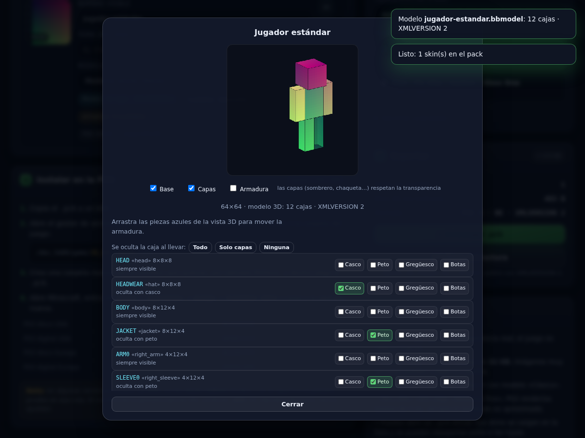
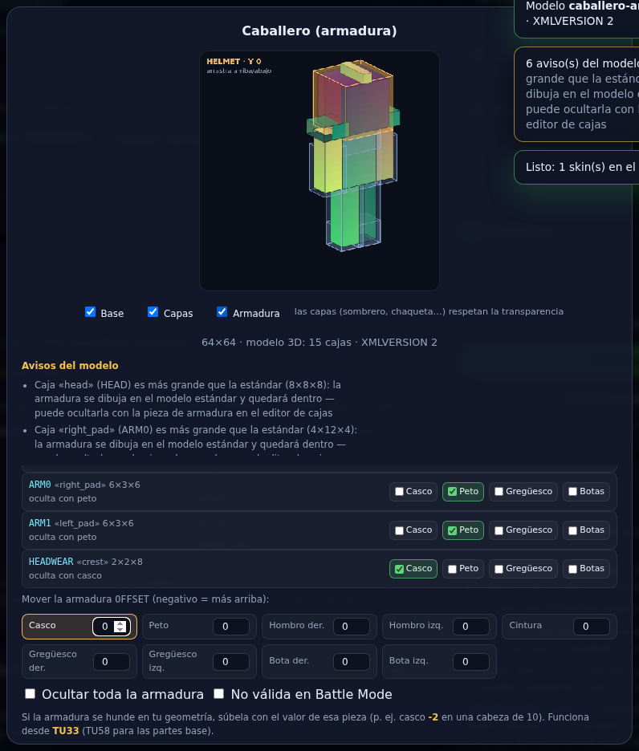
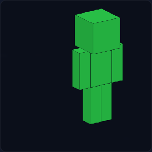

# SkinForge — skins y texture packs para Minecraft de PS3

Herramienta web **de un solo archivo** (`index.html`) con dos pestañas y **modelos 3D por `.bbmodel`**
(hay ejemplos listos en [`ejemplos/`](ejemplos/)):

| Pestaña | Qué hace |
|---|---|
| **Skins** | Convierte skins PNG de **Java** y packs `.mcpack/.zip` de **Bedrock** en un **skin pack `.pck`** para PS3 (y 360/WiiU/PS4/Vita). |
| **Texture packs** | Adapta texturas (`.zip`/`.png`) a un **texture pack `.pck`** de Legacy Console: sustituye los PNG de un pack base y convierte el endianness a PS3. |
| **Modelo 3D** (dentro de Skins) | Toma un **`.bbmodel` de Blockbench** con su textura y lo traduce a la **geometría `BOX`** que LCE admite en una skin. |

Todo ocurre en el navegador: no se sube ningún archivo a ningún servidor.

## En línea

- **GitHub Pages:** <https://isacrack.github.io/skinforge/>
- **Repositorio:** <https://github.com/Isacrack/skinforge>
- Si Pages aún no ha desplegado (o prefieres no esperar), el mismo `index.html` se sirve desde
  <https://raw.githack.com/Isacrack/skinforge/main/index.html>





---

## Pestaña 1 — Skins

1. Arrastra tus archivos:
   - **`.png` / `.jpg`** → skins de Java (64×64, 64×32, 128×128…).
   - **`.zip` / `.mcpack` / `.mcaddon`** → skin packs de Bedrock (lee `skins.json`, `manifest.json` y `texts/en_US.lang`).
   - **`.pck`** → un skin pack existente, para reexportarlo o ampliarlo (hereda el `PACKID` y las cajas `BOX`).
   - **`.bbmodel`** → modelo de Blockbench; crea la skin con la textura que lleva dentro y le engancha la geometría.
2. Ajusta nombre, tema y modelo de cada skin (clásico / Steve / Alex).
3. Pon el **nombre del pack** y pulsa **Descargar .pck**.

Genera un **PCK tipo 3** (big endian para PS3) con:

| Entrada | Tipo | Contenido |
|---|---|---|
| `0` | 4 `InfoFile` | `PACKID`, `PACKVERSION` |
| `localisation.loc` | 6 | `IDS_DISPLAY_NAME` + nombre de cada skin |
| `dlcskin########.png` | 0 `SkinFile` | textura + `DISPLAYNAME`, `DISPLAYNAMEID`, `THEMENAME`, `THEMENAMEID`, `ANIM`, `GAME_FLAGS`, `FREE` + una entrada `BOX` por caja si hay modelo 3D |

`ANIM`: `0x00000000` (64×32 clásica), `0x00040000` (moderna ancha), `0x00080000` (Alex/slim).
`GAME_FLAGS` = `0x18`, `FREE` = `1`.

---

## Pestaña 2 — Texture packs

**Lo que no se puede:** pasar un pack de Java tal cual. Minecraft de PS3 no usa un PNG por bloque: guarda
las texturas en **atlas** (`terrain.png`, `items.png`, `particles.png`, `art/kz.png`, `misc/explosion.png`,
`item/banner/Banner_Atlas.png`…) con una rejilla y un orden fijos, más `colours.col`, modelos y animaciones.
Un zip de Java no trae nada de eso, así que una «conversión» tile a tile daría un pack roto.

**Lo que sí (y hace la pestaña):** usar un pack de LCE como **base** y sustituir sus texturas.

1. Carga un **pack base `.pck`** (`x16.pck`, `x32.pck`… hecho con PCK Studio o sacado del juego).
   La pestaña te muestra nombre, formato, endianness, `PACKID` y todas sus texturas con su tamaño.
2. Suelta un **`.zip`** (o PNGs sueltos). Se emparejan por ruta:

   | En tu zip | En el pack de LCE |
   |---|---|
   | `assets/minecraft/textures/block/x.png` | `textures/blocks/x.png` |
   | `assets/minecraft/textures/blocks/x.png` | `textures/blocks/x.png` |
   | `assets/minecraft/textures/item/x.png` | `textures/items/x.png` |
   | `assets/minecraft/textures/entity/x.png` | `mob/x.png` |
   | `terrain.png`, `items.png`… | mismo nombre (atlas completo) |

   Si no coincide la ruta, prueba por nombre de archivo. Lo que no exista en el base **no se añade**
   (añadir archivos sueltos puede romper el pack) y se informa en el listado.
3. Las texturas se reescalan al tamaño exacto del destino con nearest-neighbor. Las **tiras de animación**
   (alto múltiplo del ancho) se reescalan fotograma a fotograma para no romper la animación.
4. Botón **Exportar los PNG del pack (.zip)** → edítalos en tu programa de pixel art → vuelve a soltar el zip.
   Ese es el ciclo completo.
5. **Descargar .pck**: sale en **big endian** (PS3). Si el pack base era little endian (PS4/Vita/Switch) se
   convierte al vuelo, incluidos los sub-PCK incrustados (tipos 5/8/11). También puedes cambiar el `PACKID`.

---

## Modelo 3D desde Blockbench (`.bbmodel`)

Suelta un `.bbmodel` y la herramienta:

1. Lee sus cubos (`elements`) y **empareja cada uno con una parte del jugador** por el nombre.
2. Calcula la caja `BOX` correspondiente: esquina mínima relativa al pivote de esa parte, con el **eje Y invertido**.
3. Elige el **`XMLVERSION`** del pack: `2` por defecto; `3` si algún cubo lleva un inflado propio.
4. Detecta el modelo **slim** si los brazos miden 3 px y ajusta el `ANIM`.
5. Enseña el resultado en la vista 3D isométrica (botón **3D** de la tarjeta): el modelo se pinta con
   la textura **mapeada cara por cara**, visto de frente, y las capas translúcidas se componen como en el juego.

### Tu PNG manda: ver tu skin con la geometría del modelo

Quieres saber **cómo queda tu skin con ese modelo**, así que la PNG que sueltas con el `.bbmodel` es la que
se usa como textura:

| Sueltas… | Qué pasa |
|---|---|
| **PNG + `.bbmodel` juntos** | **Una sola** skin: tu PNG como textura y la geometría del `.bbmodel`. Si el modelo traía su propia textura incrustada, se ignora (aviso en el toast). |
| **Solo el `.bbmodel`** (con textura dentro) | Skin nueva con la textura del modelo. |
| **Solo el `.bbmodel`** que apunta a un PNG por ruta | Se empareja con la PNG del lote, con la que ya esté cargada, o con la única skin sin modelo. |
| **PNG primero, luego el `.bbmodel`** | Si la skin se llama como el modelo o como su textura, el modelo se aplica a esa skin sin duplicarla. |

Los nombres se emparejan sin extensión y sin distinguir mayúsculas (`caballero.bbmodel` ↔ `caballero.png`).



### Qué se puede y qué no

El formato de LCE **no admite modelos libres**: solo cajas adosadas a las partes del jugador.
Los 23 tipos válidos son `HEAD`, `BODY`, `ARM0`, `ARM1`, `LEG0`, `LEG1`, `HEADWEAR`, `JACKET`,
`SLEEVE0`, `SLEEVE1`, `PANTS0`, `PANTS1`, `WAIST`, `LEGGING0/1`, `SOCK0/1`, `BOOT0/1`,
`ARMARMOR0/1`, `BODYARMOR` y `BELT`. La tabla con pivotes y valores exactos está en
[`PARAMETROS.md`](PARAMETROS.md).

| Se puede | No se puede |
|---|---|
| Agrandar/mover la cabeza, el cuerpo, brazos y piernas | Mallas libres, alas, armas, mesas |
| Cambiar el tamaño de las capas (sombrero, chaqueta, mangas…) | Rotar cajas (avisa y las coloca sin rotar) |
| Añadir cajas extra del mismo tipo | UV por cara independiente (se aproxima con la esquina) |
| Importar packs con `BOX` y reexportarlos intactos | Que una parte nueva se mueva con una animación propia |

Los cubos cuyo nombre no corresponde a ninguna parte se **ignoran con aviso** (se listan en el modal 3D).

### Formato del parámetro `BOX`

```
BOX  TIPO  X Y Z  ANCHO ALTO FONDO  U V  [máscaraArmadura] [espejo] [inflado]
```

- Valores de ejemplo (modelo estándar): `HEAD -4 -8 -4 8 8 8 0 0`, `BODY -4 0 -2 8 12 4 16 16`,
  `ARM0 -3 -2 -2 4 12 4 40 16`, `LEG1 -2 0 -2 4 12 4 16 48`.
- **Y invertido**: valores negativos suben la caja.
- Máscara de armadura (TU31), espejo (TU34) e inflado (TU69, requiere `XMLVERSION 3`).
- Con `XMLVERSION 1/2` los tipos overlay se inflan solos (`HEADWEAR` 0.5, el resto 0.25).

### Armadura: cómo evitar que se vea mal

El juego dibuja la armadura **sobre el modelo estándar** (cabeza 8×8×8, cuerpo 8×12×4, brazos y piernas
4×12×4). Tus cajas van encima, así que si agrandas una parte o llevas capas, el casco o el peto quedan
dentro de la geometría y se ve raro. Se arregla con la **máscara de armadura** del parámetro `BOX`
(9.º argumento, TU31+): la caja desaparece cuando llevas esa pieza.

**Cómo se hace en la herramienta:**

1. Pulsa el botón **`3D`** de la skin que tiene modelo.
2. Debajo de la vista hay una fila por caja con cuatro casillas: **Casco · Peto · Gregüesco · Botas**.
3. Marca la pieza que debe ocultar cada caja:

| Caja | Marcar | Por qué |
|---|---|---|
| `HEADWEAR` (sombrero) | Casco | en Java el casco tapa la capa del sombrero |
| `JACKET`, `SLEEVE0/1` | Peto | el peto tapa chaqueta y mangas |
| `PANTS0/1` | Gregüesco | el gregüesco tapa el pantalón |
| Cabeza/cuerpo agrandados | la pieza que los tape | si no, la armadura queda dentro de la caja |
| `BOOT0/1`, `SOCK0/1`, `LEGGING0/1`, `WAIST`, `BELT` | ya vienen con su pieza puesta | son las capas de armadura de Bedrock (TU58/TU60) |

**Atajos** (en el mismo editor): `Todo` = máscara 15 en todas las cajas · `Solo capas` = vuelve al
comportamiento de Java · `Ninguna` = quita todas las máscaras.

**Valores de la máscara:** casco `1`, peto `2`, gregüesco `4`, botas `8` — se suman (`15` = con cualquier
armadura). Se escribe como entero decimal, no hexadecimal.

**Valores por defecto al importar un `.bbmodel`:** las capas se marcan solas (`HEADWEAR`→1,
`JACKET`/`SLEEVE0/1`→2, `PANTS0/1`→4) para que se comporten como en Java. Las partes base se dejan
siempre visibles. Si una caja es más grande que su parte estándar, la herramienta **avisa** y sugiere
marcarla.

**Aviso honesto:** una versión anterior a la TU31 ignora la máscara, y la armadura de LCE no puede
cambiar de tamaño para adaptarse a tu modelo. Si quieres armadura perfecta, mantén las medidas estándar
en las partes que van tapadas.

### Modelos de ejemplo (`.bbmodel`)

En la carpeta **`ejemplos/`** hay tres proyectos de Blockbench listos para abrir, con la textura dentro:

Todos traen los cubos **agrupados en carpetas** (`head`, `body`, `right_arm`, `left_arm`, `right_leg`,
`left_leg`), igual que el modelo de jugador de Blockbench, y están guardados en **`.bbmodel` 5.0**, el
formato que usa Blockbench desde octubre de 2025:

```json
"groups":   [ { "uuid": "…", "name": "head", "origin": [0, 24, 0] } ],
"outliner": [ { "uuid": "…", "isOpen": true, "children": ["uuid-del-cubo", "…"] } ]
```

Los datos del grupo viven en `groups` y **el árbol en `outliner`**; se unen por `uuid`. Cada cubo lleva
además su `faces` con el **desplegado estándar de caja** (`north` = `[u+d, v+d, u+d+w, v+d+h]`, etc.),
para que la textura se vea bien aunque el visor no recalcule el *box UV`. (En 4.x el grupo
iba entero en línea dentro del `outliner`. La herramienta lee **los dos formatos**, y también el esquema
antiguo con `children` dentro de `groups`.)

| Fichero | Cubos | Qué demuestra |
|---|---|---|
| `ejemplos/jugador-estandar.bbmodel` | 12 | El modelo de jugador completo con las capas y sus máscaras de armadura. Punto de partida para modificar. |
| `ejemplos/caballero-armadura.bbmodel` | 15 | Cabeza de 10×10×10, hombreras (`right_pad`/`left_pad`) y cresta (`crest`) — cajas **extra** del mismo tipo, y las máscaras ya puestas (cabeza y cresta ocultas con casco, hombreras con peto). |
| `ejemplos/explorador-slim.bbmodel` | 12 | Variante **slim** (brazos de 3 px) para que se detecte el `ANIM` fino. |

Se generan con `node tools/mkbbmodel.js` (por si hay que rehacerlos o cambiar la textura).

Cada cubo lleva una propiedad **`lce_armor`** con la máscara que la herramienta debe traer marcada
(`1` casco, `2` peto, `4` gregüesco, `8` botas). Al importar, se respeta ese valor en vez del automático,
así que el modelo llega con la armadura ya resuelta.

**Textura:** los ejemplos la llevan **incrustada** (data URL). Si en Blockbench cambias la textura y el fichero
guarda una **ruta externa** (`isracrack.png`), suelta el `.bbmodel` y la PNG **a la vez**: se usa esa PNG como
textura y sale una sola skin con el modelo. Si sueltas solo el modelo, la herramienta busca una skin ya
cargada con ese nombre y, si no la hay, avisa.

**Y desde la propia página:** en la tarjeta *«Si la armadura se ve mal»* hay un botón
**«⬇ Descargar .bbmodel de ejemplo»** que genera la plantilla con **la textura de la skin que tengas
cargada** — el ciclo completo sin salir del navegador:

```
descargar plantilla → abrir en Blockbench → mover/grandes cajas → guardar .bbmodel → arrastrarlo aquí
```

### Cómo editarlo en Blockbench (3 pasos)

1. **File → Open** y elige el `.bbmodel` (la textura ya viene dentro; si no, *File → Import → Texture*).
2. Los cubos vienen **agrupados en carpetas** como en el modelo de jugador de Blockbench:
   `head` (`head`, `hat`), `body` (`body`, `jacket`), `right_arm`, `left_arm`, `right_leg`, `left_leg`.
   Mueve o redimensiona cubos en el panel de la izquierda. **No cambies los nombres**: si el nombre del
   cubo no dice nada, la herramienta usa **el nombre de la carpeta** que lo contiene, así que puedes
   meter cubos nuevos dentro de la carpeta que toque y se colocarán bien.
   Para añadir geometría, **duplica un cubo** y renómbralo dejando la palabra clave (`right_pad`, `crest`…).
3. **File → Save as** → `.bbmodel`, y suéltalo otra vez en la herramienta. Si alguna caja se pasa de la
   medida estándar, la herramienta avisa y puedes ocultarla con la armadura desde el editor.

### Mover la armadura en vez de ocultarla (`OFFSET`)

Si la armadura no sobra sino que **se hunde** dentro de tu geometría, el parámetro `OFFSET` (TU33) la
desplaza en vertical.

**En 3D:** la vista del botón `3D` dibuja la skin con su **textura real por cara**, de frente y sin
espejar (se ve la cara del muñeco), con las **capas** (sombrero, chaqueta, mangas, pantalones) respetando
la transparencia. Tres casillas debajo: **Base**, **Capas** y **Armadura** — por defecto solo se ve el
modelo; la armadura se enciende a mano y entonces salen las **nueve piezas** encima (azul
translúcido: casco, peto, hombreras, cintura, gregüescos y botas). **Arrástralas con el ratón** hacia
arriba o abajo y se mueven de verdad; la pieza elegida se pinta en naranja y sale su valor en la esquina.
Si dos piezas se solapan, pincha primero su fila en la lista (bloque «Mover la armadura») y luego arrastra
en cualquier punto de la vista.

Funciona **con cualquier skin**, tenga `.bbmodel` o no: si no hay modelo se dibuja el jugador estándar.
Las piezas se dimensionan a partir de tus cajas, así que ves si el casco cubre o no tu cabeza de 10 px.

**Con el número:** un campo por pieza en el bloque «Mover la armadura», **negativo = más arriba**.

```
OFFSET  HELMET Y -2      ← casco dos unidades más arriba (cabeza de 10 px)
OFFSET  CHEST  Y  1      ← peto uno más abajo
```

| Tipos de `OFFSET` | Desde |
|---|---|
| `HELMET`, `CHEST`, `SHOULDER0`, `SHOULDER1`, `WAIST`, `PANTS0`, `PANTS1`, `BOOT0`, `BOOT1`, `TOOL0`, `TOOL1` | TU33 |
| `HEAD`, `BODY`, `ARM0`, `ARM1`, `LEG0`, `LEG1` (arrastran también sus capas y su armadura) | TU58 |

Los valores se **suman** entre sí: `HELMET Y -2` + `HEAD Y -2` dejan el casco en su sitio y la cabeza dos
unidades más alta.

### Flags de skin

| Casilla | Parámetro | Bit |
|---|---|---|
| Ocultar toda la armadura | `ANIM` | 9 (`0x00000100`, TU17) |
| No válida en Battle Mode | `GAME_FLAGS` | 1 (`0x01`, TU36) |

### Equivalencias con PCK Studio

| En PCK Studio (Custom Skin Editor) | Aquí |
|---|---|
| `Mask with helmet / chestplate / leggings / boots` | Casillas **Casco · Peto · Gregüesco · Botas** de cada caja |
| Pestaña **Offset** (`HELMET`, `CHEST`…) | Bloque **«Mover la armadura»** (`OFFSET`) |
| **Hide All Armor** (Skin Flags) | ☐ Ocultar toda la armadura |
| **Unfair in Competitive Battle Mode** | ☐ No válida en Battle Mode |
| **Armor Panel** (la 3.ª vista) | Solo previsualiza la capa de armadura: no escribe nada en el `.pck` |
| `Type: HEAD / BODY / …` | El tipo de cada caja (`BOX`) |
| `Mirror Texture` | Automático en skins 64×32 para brazo/pierna izquierdos |

---

## Cómo instalar los dos en la PS3

Ambos van **en el mismo sitio**, cada uno en su carpeta:

```
/dev_hdd0/game/<ID_DEL_JUEGO>/USRDIR/DLC/
├── MiTexturas/    → texture pack .pck
└── MisSkins/      → skin pack .pck
```

| Versión | Title ID |
|---|---|
| PS3 disco USA | `BLUS31426` |
| PS3 digital USA | `NPUB31419` |
| PS3 disco Europa | `BLES01976` |
| PS3 digital Europa | `NPEB01899` |

Pasos (requiere CFW/HEN):

1. Copia los `.pck` a un USB.
2. Con multiMAN / webMAN / Irisman abre `dev_hdd0/game/<TITLEID>/USRDIR/DLC/` y crea una carpeta por pack.
3. Pega dentro cada `.pck`.
4. **Skins:** Minecraft → *Skins* (o *Opciones → Juego → Cambiar skin*) → pestaña nueva.
   **Texturas:** *Opciones → Juego → Texture pack*; a veces hace falta recargar el mundo.
5. En algunas versiones también se leen desde `USRDIR/CU/DLC/`.

---

## Formato del contenedor

```
int32  pckType (3)
int32  lutCount
[ int32 index, string key ] * lutCount
int32  xmlVersion            (sólo si la LUT contiene "XMLVERSION")
int32  assetCount
[ int32 size, int32 type, string filename ] * assetCount
[ int32 paramCount, [ int32 keyIndex, string value ] * n, bytes data ] * assetCount
```

`string` = `int32` longitud en caracteres + `caracteres*2` bytes **UTF-16** con el endianness del pack + `int32` de relleno.
Tipos de archivo: `0` SkinFile, `1` CapeFile, `2` TextureFile, `4` InfoFile, `5` TexturePackInfoFile,
`6` LocalisationFile, `8` AudioFile, `9` ColourTableFile, `11` SkinDataFile.

`localisation.loc` / `languages.loc` se escriben en **versión 2** (big endian, UTF-8 con longitudes de 16 bits).

---

## Estructura del proyecto

```
index.html              ← LA HERRAMIENTA (autocontenida, sin dependencias)
build.py                ← compila src/* dentro de index.html
src/pck.js              ← núcleo: lector/escritor de .pck y .loc (funciona también en Node)
src/app.js              ← interfaz: pestañas, drag&drop, ZIP, previsualización, texturas
src/style.css           ← estilos
src/index.template.html ← plantilla
test/pck.test.js        ← tests del núcleo (node test/pck.test.js)
test/e2e.js             ← E2E de la pestaña Skins (node test/e2e.js)
test/e2e-tex.js         ← E2E de la pestaña Texture packs (node test/e2e-tex.js)
test/e2e-3d.js          ← E2E del modelo 3D .bbmodel → BOX (node test/e2e-3d.js)
test/params.js          ← auditoría de los 105 parámetros del .pck (node test/params.js)
test/bbmodel.test.js    ← valida el árbol de carpetas de los .bbmodel (node test/bbmodel.test.js)
test/lib.js             ← PNG/ZIP mínimos para los tests
test/verify.py          ← verificador independiente del .pck (python3 test/verify.py pack.pck)
test/mkskins.js         ← skins de ejemplo · test/shots.js ← capturas
```

Reconstruir tras tocar `src/`:

```bash
python3 build.py
```

---

## Verificación

- **8 tests unitarios** del formato: layout byte a byte, round-trip BE/LE, `XMLVERSION`,
  UTF-16 con acentos y emojis, IDs únicos, ficheros basura.
- **E2E de Skins** en Chromium: PNGs reales, `.mcpack` de Bedrock, `.pck` existente, descarga y validación de bytes.
- **E2E de Texture packs**: pack base sintético (little endian, con sub-PCK), zip con rutas de Java moderno y
  antiguo, reescalado, animación por fotogramas, conversión a big endian (incluido el sub-PCK), `colours.col`
  intacto, export `.zip` y reimportación.
- **E2E del modelo 3D**: `.bbmodel` sintético del modelo de jugador (con la cabeza agrandada y un cubo
  inservible), comprobación de las 12 cajas `BOX` contra los valores estándar de LCE, inflado propio →
  `XMLVERSION 3`, detección slim, redondeo de decimales, vista 3D pintada y ciclo importar → exportar sin perder la geometría.
- **Auditoría de parámetros** (`node test/params.js`): **86 comprobaciones** sobre un `.pck` generado —
  cabecera, LUT, codificación de strings, `.loc`, `ANIM` por modelo, `GAME_FLAGS`/`FREE`, rango de IDs,
  tamaño de PNG y las reglas de `BOX` (pivotes, eje Y, espejo, tipos válidos).
- `test/verify.py` relee los `.pck` con una implementación independiente (escrita desde el lector de
  OMI-Filetype-Library) y comprueba que no sobren bytes.

**Aviso honesto:** el formato está validado byte a byte contra la especificación que usan PCK Studio / OMI,
pero **no se ha probado en una PS3 física**. Si algo falla, revisa primero la ruta de instalación, el endianness
y que ningún PNG de skin pase de 32 KB.

---

## Créditos del formato

La ingeniería inversa del contenedor PCK está documentada por
[OMI-Filetype-Library](https://github.com/LCERD/OMI-Filetype-Library) y
[PCK Studio](https://github.com/LCERD/PCK-Studio) (PhoenixARC, MayN-L, NessieHax, EternalModz y
colaboradores, GPL-3.0). Esta página es una implementación independiente del mismo formato, sin código copiado.

No está afiliada a Mojang, Microsoft ni 4J Studios. «Minecraft» es una marca de Mojang AB.
